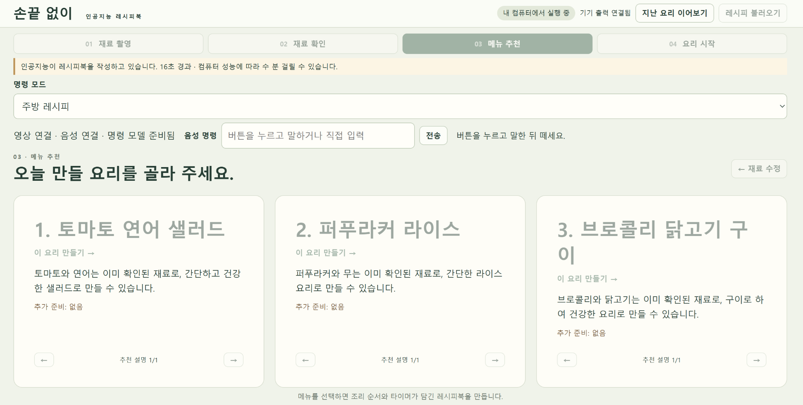
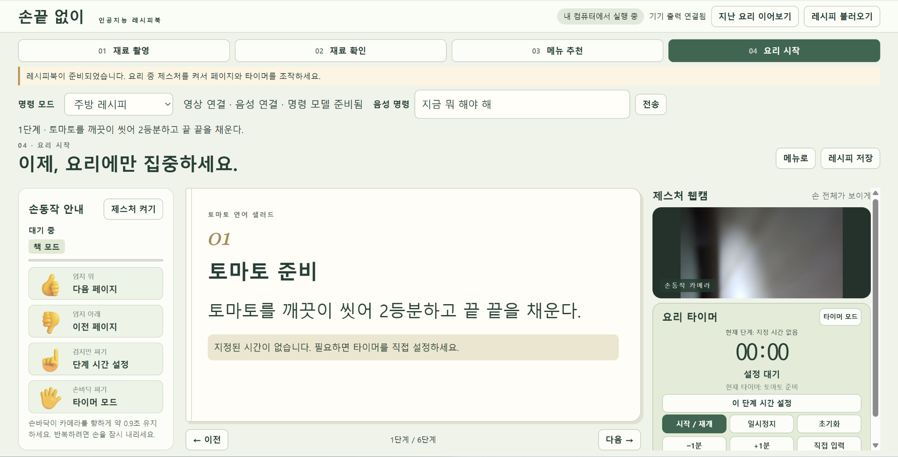
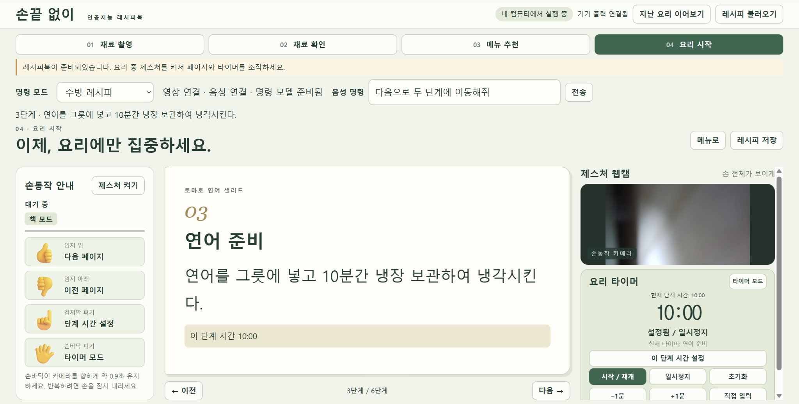
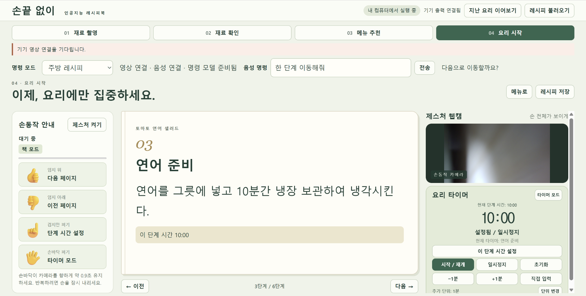
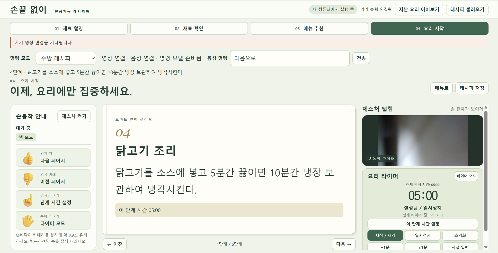

# 손끝 없이 · 인공지능 레시피북

라즈베리파이 카메라로 재료를 찍으면 노트북이 만들 수 있는 메뉴를 추천하고, 고른 요리를 한 단계씩 펼쳐 보여 준다. 조리 중에는 웹캠에 엄지를 들어 다음 페이지를 넘기거나, 라즈베리파이의 버튼을 누르고 “지금 뭐 해야 해?”라고 물어 현재 할 일을 확인할 수 있다.

## 재료 사진이 레시피북이 되기까지

| 순서 | 사용자 동작 | 화면과 기기의 반응 |
|---|---|---|
| 01 재료 촬영 | 라즈베리파이 카메라 앞에 재료를 놓고 촬영한다. | 노트북에서 사진을 분석해 재료 후보를 만든다. |
| 02 재료 확인 | 사진과 후보 목록을 대조하고 잘못 읽은 이름이나 빠진 재료를 수정한다. | 사용자가 확정한 재료 목록을 메뉴 추천에 사용한다. |
| 03 메뉴 추천 | 추천 메뉴 세 가지의 설명과 추가 준비물을 보고 하나를 고른다. | 선택한 메뉴의 한국어 조리 순서와 단계별 타이머를 생성한다. |
| 04 요리 시작 | 손동작이나 음성으로 레시피를 넘기고 타이머를 조작한다. | 브라우저가 현재 단계와 시간을 표시하고, 라즈베리파이 OLED에서도 진행 상황을 확인할 수 있다. |

완성한 레시피북은 파일로 저장해 다시 불러올 수 있다. 같은 브라우저에서는 ‘지난 요리 이어보기’로 진행 중이던 요리를 다시 연다.

## 실제 시연 · 토마토 연어 샐러드

### 1. 재료를 확인하고 메뉴 고르기

이번 시연에서는 토마토 연어 샐러드, 파프리카 라이스, 브로콜리 닭고기 구이가 추천됐다. 첫 번째 메뉴를 고른 뒤 화면 상단에 레시피북 작성 경과 시간이 표시된다.



### 2. 현재 할 일 묻기

버튼을 누른 채 “지금 뭐 해야 해?”라고 말한 뒤 손을 뗀다. 화면은 1단계 ‘토마토 준비’에 머물고, 음성 명령 아래에 해당 단계의 설명이 표시된다. 오른쪽에는 손을 비춰 볼 웹캠과 타이머가 있다.



### 3. 한 번 말해서 두 단계 이동하기

1단계에서 “다음으로 두 단계 이동해 줘”라고 하면 3/6 ‘연어 준비’로 이동한다. 오른쪽 타이머에는 새 단계의 지정 시간인 10분이 표시된다. 이 화면에서 타이머 상태는 ‘설정됨 / 일시정지’이며, ‘시작 / 재개’를 누르면 시간이 흐른다.



### 4. 모호한 명령에 이어 답하기

“한 단계 이동해 줘”에는 방향이 없다. 레시피북은 3단계를 유지하면서 “다음으로 이동할까요?”라고 되묻는다.



버튼을 다시 누르고 “다음으로”라고 답하면 앞에서 말한 이동량 한 단계를 적용한다. 화면은 4/6으로 바뀌고 이 단계에 저장된 5분이 타이머에 표시된다.



### 5. 현재 단계의 시간 확인하기

“몇 분 기다려야 해?”처럼 시간을 물을 수 있다. 아래 시연에서는 음성 인식 결과가 **‘몇 번 기다려야 해’**로 기록됐다. 화면에는 4단계 설명과 지정 시간 **05:00**이 보인다. 인식 문장이 달라졌을 때는 상단 입력란에 질문을 직접 입력해 전송할 수 있다.


## 장치와 모델의 역할

| 실행 위치 | 구성 | 담당 기능 |
|---|---|---|
| 라즈베리파이 5 | 파이 카메라, SPH0645 디지털 마이크, 택 스위치, OLED | 재료 촬영, 버튼을 누른 동안 녹음, 진행 단계 표시 |
| 라즈베리파이 5 | whisper.cpp와 다국어 기본 모델, Qwen3-1.7B | 한국어 음성을 글로 바꾸고 이동·질문·되묻기 의도를 판단 |
| Windows 노트북 | Qwen2.5-VL-3B와 시각 입력용 프로젝터, Qwen3-4B | 재료 사진 분석, 메뉴 추천, 한국어 레시피 생성, 웹 서버 실행 |
| 노트북 브라우저와 웹캠 | 손동작 인식 모델, 레시피 화면 | 손동작 입력, 페이지 이동, 타이머 조작, 레시피 저장·불러오기 |

**책 모드의 손동작**은 엄지 위가 다음 페이지, 엄지 아래가 이전 페이지, 검지만 펴기가 현재 단계 시간 설정, 손바닥 펴기가 타이머 모드 전환이다. ‘제스처 켜기’를 누르고 손 전체를 웹캠에 보인 채 약 0.9초 유지한다. 같은 동작을 반복하려면 손을 잠시 내린다.

## 개발 과정

- **1일차** — 재료 촬영부터 메뉴 선택, 레시피 생성, OLED 단계 표시까지 연결했다. 사진 인식 결과를 직접 확인하고 고칠 수 있게 했다.
- **2일차** — I²S 마이크와 택 스위치를 연결하고 한국어 음성 인식을 추가했다. 실제 버튼으로 “다음 단계”, “이전 단계”를 말해 레시피가 이동하는 것을 확인했다.
- **3일차** — 기기에서 명령 의도를 판단하도록 확장했다. 여러 단계 이동, 현재 단계와 시간 질문, 방향을 되묻고 후속 답변을 적용하는 대화를 추가했다. 노트북에서는 손동작 안내·레시피·타이머의 배치를 유지하면서 웹캠 미리보기 높이를 확보했다.

## 실행 방법

노트북과 라즈베리파이를 같은 공유기에 연결한다. 다음 명령은 프로젝트가 노트북의 다운로드 폴더에 있고, 라즈베리파이에 기존 카메라·OLED 환경과 Whisper가 준비된 구성을 기준으로 한다. 기기별 준비 사항과 실행 예시는 [3일차 실행 안내](kitchen_book/DAY3_실행방법.md)에 정리했다.

### 처음 한 번 · 노트북 Windows CMD

아래 예시의 IP 주소는 라즈베리파이 터미널에서 `hostname -I`로 확인한 주소로 바꾼다. 대용량 모델은 별도 다운로드하며 Windows와 라즈베리파이가 사용하는 모델이 다르다.

```bat
cd /d "%USERPROFILE%\Downloads\Kitchen-Day3\kitchen_book"
py -3.12 -m venv .venv
.venv\Scripts\python.exe -m pip install -r source\requirements.txt
scripts\get_pc_models.cmd
set "PI_IP=192.168.0.25"
scripts\install_day3_device.cmd pi@%PI_IP%
ssh pi@%PI_IP%
```

### 첫 번째 창 · 라즈베리파이

SSH로 접속한 창에서 실행한다. 설치 스크립트는 기존 Whisper 실행 파일과 모델을 확인하고 명령 판단용 모델을 준비한다. 첫 설정을 마친 뒤에는 프로젝트 폴더에서 마지막 서버 명령만 실행하면 된다.

```bash
cd ~/kitchen_book
bash scripts/setup_day3_pi.sh
/home/pi/venv/bin/python raspberrypi/camera_server.py --voice --alsa plughw:0,0
```

`plughw:0,0`은 시연 장치의 마이크 카드 0, 장치 0을 뜻한다. 다른 장치에서는 `arecord -l` 출력에 맞춘다. 장치 서버가 실행된 창은 열어 둔다.

### 두 번째 창 · 노트북 Windows CMD

새 CMD 창에서 아래 명령을 실행한다. IP 주소는 앞에서 확인한 라즈베리파이 주소로 바꾼다.

```bat
cd /d "%USERPROFILE%\Downloads\Kitchen-Day3\kitchen_book"
source\run_windows.bat --device 192.168.0.25
```

노트북에서 [레시피북 열기](http://127.0.0.1:8000)를 선택한다. 음성 제어만 빠르게 시연하려면 ‘레시피 불러오기’에서 [예제 채소 샐러드](kitchen_book/examples/kitchen-demo.json)를 연다. 예제의 마지막 단계에서 “몇 분 기다려야 해?”라고 물으면 저장된 시간인 1분을 확인할 수 있다. 위 사진 속 토마토 연어 샐러드는 시연 중 생성한 별도 레시피다.
